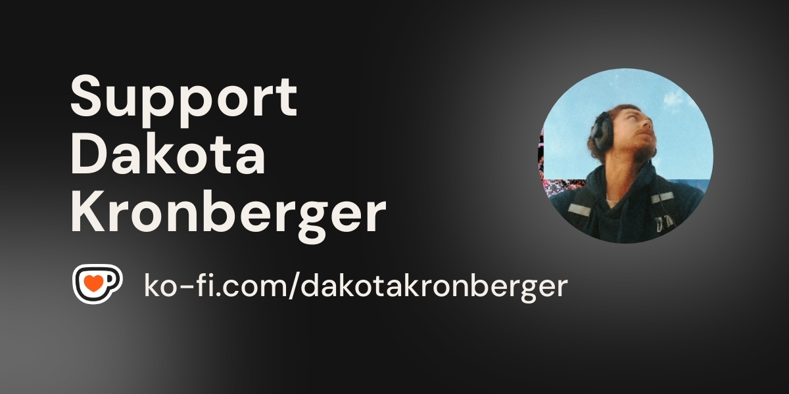
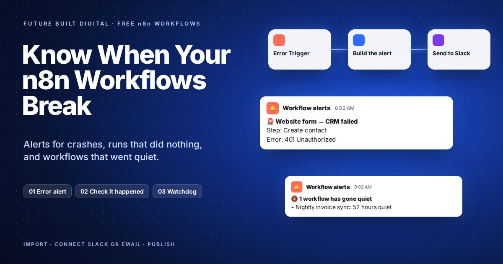
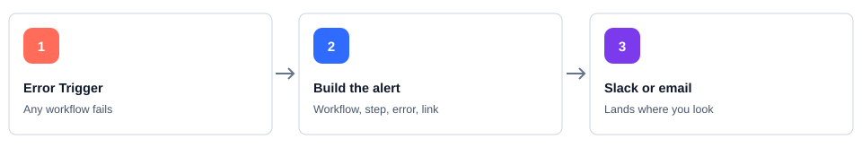
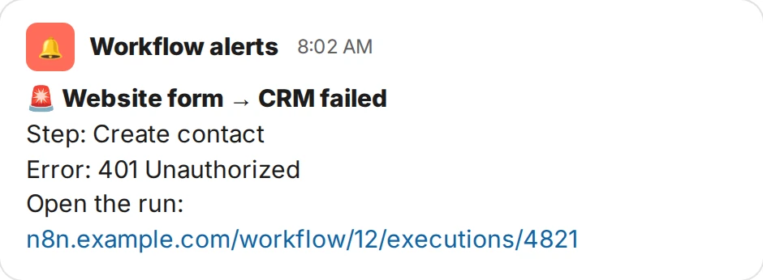
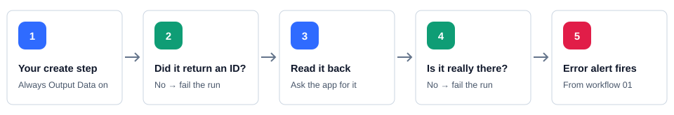
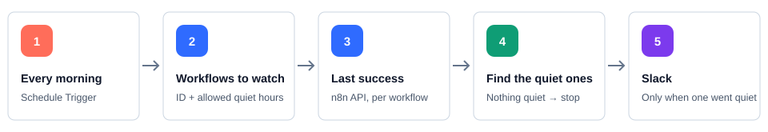
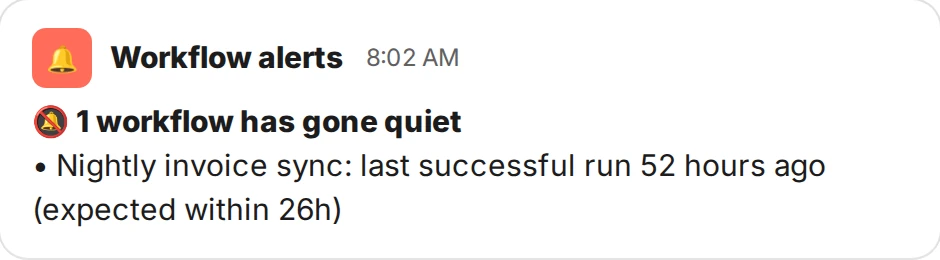
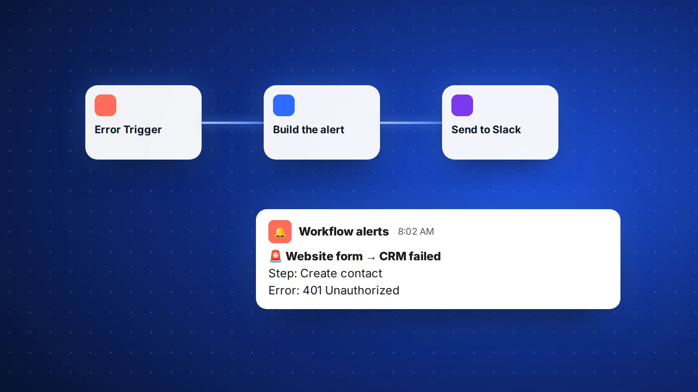

  

<a href="https://ko-fi.com/dakotakronberger"><strong>Support Dakota on Ko-fi ☕</strong></a>

---

  

<h1 align="center">Know When Your n8n Workflows Break</h1>
<h3 align="center">(Including the Runs That Say “Succeeded” and Did Nothing)</h3>

<strong>Three workflows you import into n8n: an alert when anything fails, a check that the thing you created actually exists, and a morning watchdog for workflows that quietly stopped running.</strong>

By <strong>Dakota Kronberger</strong> · <a href="https://www.futurebuiltdigital.com">Future Built Digital</a> · November 2026

  <a href="#workflows"><strong>Explore the 3 workflows ↓</strong></a> &nbsp; · &nbsp;
  <a href="https://github.com/kodyk448/n8n-error-alerts/raw/refs/heads/main/downloads/n8n-error-alerts.zip"><strong>Download all workflows ↓</strong></a> &nbsp; · &nbsp;
  <a href="https://www.futurebuiltdigital.com/start-a-project"><strong>Get help with your automations ↗</strong></a>

Free to import, change and share. MIT license. No sign-up.

<table>
  <tr>
    <td align="center" width="33%"><strong>3 WORKFLOWS</strong> Import, connect a login, publish</td>
    <td align="center" width="33%"><strong>3 KINDS OF FAILURE</strong> Crashes, no-ops and silence</td>
    <td align="center" width="33%"><strong>SLACK OR EMAIL</strong> Or anything n8n can send to</td>
  </tr>
</table>

---

## Find the failure you’re worried about

| What happened | Workflow | File |
| :--- | :--- | :--- |
| 🚨 **A step errored and the run stopped** | [01 · Error alert](#error-alert) | [`01-error-alert-slack.json`](workflows/01-error-alert-slack.json) · [`01-error-alert-email.json`](workflows/01-error-alert-email.json) |
| 🤫 **The run says Succeeded, but nothing was created** | [02 · Check it actually happened](#check-it) | [`02-check-it-actually-happened.json`](workflows/02-check-it-actually-happened.json) |
| 🔕 **The workflow just stopped running** | [03 · Quiet workflow watchdog](#watchdog) | [`03-quiet-workflow-watchdog.json`](workflows/03-quiet-workflow-watchdog.json) |

**Also in this guide:** [Why green doesn’t mean done](#green-isnt-done) · [How to import](#import) · [Recipes](#recipes) · [When alerts aren’t enough](#when-alerts-arent-enough) · [Start with the error alert](#start-here)

---

You find out a workflow broke when a client asks why their lead never got a reply. You open n8n, and the execution list is a wall of green.

That’s the uncomfortable part of automation. When a step crashes, at least n8n knows. It marks the run as failed, and if you’ve set up an error workflow, you hear about it. But plenty of breakages never crash. The API answers “200 OK” with an error tucked inside. A search comes back empty, so every step after it simply doesn’t run, and n8n calls that a success. A form’s webhook URL changes and nothing ever arrives, so there’s no run to fail.

People on r/n8n trade these stories all the time: [how did you find out about your last silent failure?](https://www.reddit.com/r/n8n/comments/1x347kc/how_did_you_find_out_about_your_last_silent/) The common answer is “a customer told me.”

So we built three small workflows, one for each way a workflow breaks. Import them, connect Slack or email, and point your workflows at them. Start with the first; add the other two where they matter.

## Why green doesn’t mean done

n8n’s execution status tells you whether the workflow *ran*, not whether the business task *finished*. These are the ways a run goes wrong without turning red.

| What happens | Why n8n says Succeeded | What catches it |
| :--- | :--- | :--- |
| **A step returns no items** | Steps after an empty result don’t run, and stopping early isn’t an error. | Turn on **Always Output Data** and check the result ([02](#check-it)) |
| **The API says OK, with an error inside** | Some APIs reply HTTP 200 with something like `{"ok": false}`. n8n only sees the 200. | Check the body, not the status code ([02](#check-it)) |
| **A step is set to continue on error** | **On Error: Continue** keeps the run going and the error ends up in the data. | Check for the error field, or fail the run on purpose ([02](#check-it)) |
| **The trigger stopped firing** | No trigger, no run, nothing to fail. Webhook URL changed, workflow unpublished, polling login expired. | A watchdog that expects a run ([03](#watchdog)) |
| **A step actually crashed** | It doesn’t. This one turns red. You just have to be told. | The error alert ([01](#error-alert)) |

---

### 🚨 01 · Error alert

**[Get told the minute a workflow fails ↗](workflows/01-error-alert-slack.json)**

**Best for:** Every n8n instance, before anything else

  <picture>
    <source media="(max-width: 600px)" srcset="assets/flow-error-alert-mobile.svg">
    
  </picture>

n8n has a built-in way to react to failures: an **error workflow** that starts with the Error Trigger. You point each of your workflows at it, and when one fails, n8n runs it with the details. This one turns those details into a single readable message: which workflow, which step, the error, and a link to the failed run. It handles both shapes n8n sends, including the one where the trigger itself failed and no run exists. There’s a Slack version and an email version.

| Workflow details | What to know |
| :--- | :--- |
| **What it catches** | Any production run of a connected workflow that ends in an error, plus trigger failures. |
| **What you need** | A Slack login (bot or app) or an SMTP email login. |
| **Setup** | • Import, connect Slack or SMTP, pick the channel or address, publish • In each workflow: **Settings → Error workflow → Error alert → Save** |
| **The catch** | It doesn’t fire when you click **Execute** in the editor, only for production runs. The run link needs the execution to be saved, which is the default. |
| **Files** | [`01-error-alert-slack.json`](workflows/01-error-alert-slack.json) · [`01-error-alert-email.json`](workflows/01-error-alert-email.json) |

> **Try this today:** Import the Slack version, connect it to every published workflow, then break one on purpose (a wrong URL in a test workflow) and wait for the message.

[Download the Slack version ↓](https://github.com/kodyk448/n8n-error-alerts/raw/refs/heads/main/workflows/01-error-alert-slack.json) · [Error Trigger docs ↗](https://docs.n8n.io/integrations/builtin/core-nodes/n8n-nodes-base.errortrigger/) · [↑ Browse the guide](#contents)

### 🤫 02 · Check it actually happened

**[Fail the run when nothing was created ↗](workflows/02-check-it-actually-happened.json)**

**Best for:** Workflows that create something a customer or teammate depends on: a CRM contact, an invoice, a booking, a row

  <picture>
    <source media="(max-width: 600px)" srcset="assets/flow-check-it-mobile.svg">
    
  </picture>

This is a pattern, not a finished workflow. After the step that creates something, it asks two questions: did the app send back an ID, and when we ask for that ID, does the record exist? If either answer is no, a **Stop and Error** step fails the run on purpose, with the response in the message, and your error alert from 01 picks it up. **Always Output Data** is switched on for the HTTP steps so an empty response still reaches the check instead of ending the run quietly. Copy the two checks into your own workflows and swap the example URLs for your app’s.

| Workflow details | What to know |
| :--- | :--- |
| **What it catches** | Empty responses, “OK” responses with no record, and records that don’t exist when you look. |
| **What you need** | The step you already have, and an app you can read the record back from (most CRMs, sheets and accounting tools). |
| **Setup** | • Paste the two checks after your create step • Change `$json.id` to whatever your app returns (`$json.contact.id`, `$json.data[0].id` ...) • Turn on **Always Output Data** on your create step |
| **The catch** | Reading back costs one extra API call per run. Some apps take a few seconds before a new record can be read; add a Wait step if the check fails on records that do exist. |
| **Files** | [`02-check-it-actually-happened.json`](workflows/02-check-it-actually-happened.json) |

> **Try this today:** Add the “Did it return an ID?” check after the one step in your busiest workflow that creates a record.

[Download the pattern ↓](https://github.com/kodyk448/n8n-error-alerts/raw/refs/heads/main/workflows/02-check-it-actually-happened.json) · [Stop and Error docs ↗](https://docs.n8n.io/integrations/builtin/core-nodes/n8n-nodes-base.stopanderror/) · [↑ Browse the guide](#contents)

### 🔕 03 · Quiet workflow watchdog

**[Hear about workflows that stopped running ↗](workflows/03-quiet-workflow-watchdog.json)**

**Best for:** Webhook and form workflows, nightly syncs, anything you expect to run every day

  <picture>
    <source media="(max-width: 600px)" srcset="assets/flow-watchdog-mobile.svg">
    
  </picture>

The hardest failure to notice is the one that produces nothing. Every morning, this workflow asks n8n’s own API when each workflow you list last ran successfully. If one has been quiet longer than you allow (say 24 hours for a website form), you get one Slack message listing the quiet ones. If everything ran, it stays silent, so you don’t learn to ignore it.

| Workflow details | What to know |
| :--- | :--- |
| **What it catches** | Triggers that stopped firing: changed webhook URLs, unpublished workflows, expired logins on polling triggers, a form that stopped sending. |
| **What you need** | An n8n API key (**Settings → n8n API → Create an API key**) and a Slack login. |
| **Setup** | • In **Last successful run**, set your n8n address and create a Header Auth login: name `X-N8N-API-KEY`, value your key • In **Workflows to watch**, list each workflow ID (from its URL) and its allowed quiet hours • Publish |
| **The catch** | n8n’s API isn’t available on the n8n Cloud free trial. The watchdog reads saved successful runs, so it needs those to be saved (the default) and kept long enough. |
| **Files** | [`03-quiet-workflow-watchdog.json`](workflows/03-quiet-workflow-watchdog.json) |

> **Try this today:** Add your website form workflow with 24 hours, and your most important nightly job with 26.

[Download the watchdog ↓](https://github.com/kodyk448/n8n-error-alerts/raw/refs/heads/main/workflows/03-quiet-workflow-watchdog.json) · [n8n API docs ↗](https://docs.n8n.io/api/) · [↑ Browse the guide](#contents)

---

## How to import a workflow

1. Open the workflow file above and click **Download raw file** (or grab [all of them as a zip](https://github.com/kodyk448/n8n-error-alerts/raw/refs/heads/main/downloads/n8n-error-alerts.zip)).
2. In n8n, create a new workflow, open the **⋯** menu and choose **Import from File**. You can also copy the JSON and paste it straight onto the canvas.
3. Open each step with a warning icon and connect your own login (Slack, SMTP, or the n8n API key). No credentials are included in these files.
4. Publish the workflow (on older n8n versions, switch it to **Active**).

The workflows use standard n8n steps only: Error Trigger, Code, HTTP Request, If, Stop and Error, Schedule Trigger, Slack and Send Email. No community nodes.

## Recipes

**Send it somewhere else.** Delete the Slack step and add Telegram, Discord, Microsoft Teams or an SMS step. Use `{{ $json.text }}` as the message. For email, `{{ $json.subject }}` is ready too.

**Running workflows for clients?** Prefix your workflow names with the client (“Acme · Form → CRM”). The alert includes the workflow name, so you know whose it is before you open n8n. Run one error alert per n8n instance.

**Check APIs that say OK when they aren’t.** Add an If step after the call that checks the body, like `{{ $json.ok }}` is true, or `{{ $json.error }}` doesn’t exist, and send the false branch to Stop and Error. Slack’s own Web API works this way: it answers HTTP 200 with `"ok": false` when something’s wrong.

**Watch the result, not the workflow.** Swap the watchdog’s n8n API call for your own data: “how many new leads arrived in the CRM today?” If the answer is zero on a weekday, something upstream broke, even if every workflow ran.

**Retry before you alert.** For flaky APIs, open the step’s **Settings** and turn on **Retry On Fail** with a few tries and a wait between them. The error alert only fires if the last try fails.

---

## When alerts aren’t enough

All three workflows run inside n8n. **If n8n itself is down, nothing here can tell you.** That needs something outside n8n watching it. Self-hosted n8n has a health endpoint (`/healthz`) on the main server, which a free uptime monitor can check every few minutes. [UptimeRobot](https://github.com/kodyk448/free-tools-for-small-business#uptimerobot) is one option in our free tools guide.

**Alerts you ignore are worse than none.** If the error alert fires ten times a day for the same flaky step, fix that step (retries, a timeout, a check) instead of muting the channel. The watchdog only speaks up when something went quiet for exactly that reason.

**Alerts tell you something broke, not what it broke.** A failed “create invoice” step means a customer may not have been billed. Keep a short note per workflow of what to check when it fails, and who fixes it. If you build workflows for clients, that note belongs in the handoff.

If you’re running workflows a business depends on and want them built to fail loudly from the start, that’s the work we do. See [process automation](https://www.futurebuiltdigital.com/solutions/process-automation), or read [how to test an integration before you sign](https://www.futurebuiltdigital.com/resources/test-an-integration-before-you-sign).

---

## Start with the error alert

Don’t set up all three today. Import the error alert, connect it to every published workflow, and break a test workflow on purpose to see the message arrive. That alone covers every run that crashes.

Then add the check to the one workflow that would hurt most if it silently did nothing, and put your form and nightly jobs on the watchdog.

Want a hand making your automations reliable? Email [dakota@futurebuiltdigital.com](mailto:dakota@futurebuiltdigital.com) or fill out the [quote form](https://www.futurebuiltdigital.com/start-a-project). Happy to build it or just point you in the right direction.

We add workflows here as we build them for clients. [Subscribe](https://www.futurebuiltdigital.com/sign-in?next=/resources) to get the next one, plus whatever else we’re building... no spam, just useful stuff.

**[Explore more resources ↗](https://www.futurebuiltdigital.com/resources) · [25 free tools for small business ↗](https://github.com/kodyk448/free-tools-for-small-business) · [Talk to Dakota ↗](https://www.futurebuiltdigital.com/start-a-project)**

---

### Keep these workflows useful

n8n changes. If a workflow doesn’t import cleanly on your version, or a step was renamed, [open an issue](https://github.com/kodyk448/n8n-error-alerts/issues/new) with your n8n version and what happened, or send a pull request. You can also email [dakota@futurebuiltdigital.com](mailto:dakota@futurebuiltdigital.com).

If these saved you a bad morning, **star the repository** so you can find them again and help other n8n builders find them.

*MIT license. n8n is a trademark of n8n GmbH; this project isn’t affiliated with n8n. Alert previews show example data. [Image sources](assets/README.md).*

---

  

<a href="https://ko-fi.com/dakotakronberger"><strong>Support Dakota on Ko-fi ☕</strong></a>

<a href="#top">↑ Back to the top</a>

